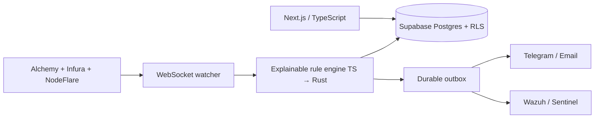

# DeFi Sentinel

**A watch-only DeFi portfolio tracker with a Web3 Security Operations Center.**

DeFi users routinely grant contracts permission to spend tokens or move entire NFT collections. Those permissions outlive the transaction that requested them, off-chain signatures are hard to interpret, and a malicious drain can complete within one block. Traditional portfolio trackers show value; traditional SIEMs do not understand EVM approvals.

DeFi Sentinel joins both worlds: it tracks a multichain portfolio, detects dangerous authorization and fund-flow patterns, explains the evidence, and sends normalized incidents to Wazuh or Microsoft Sentinel.

> Status: research-complete / implementation backlog ready. DeFi Sentinel never asks for or stores seed phrases or private keys and never sends transactions.

## What it detects

| Detection | Evidence |
|---|---|
| Unlimited ERC-20 approvals | `approve`, `Approval`, live `allowance` |
| NFT-wide operators | ERC-721/1155 `setApprovalForAll` |
| EIP-2612 permits | EIP-712 payload or on-chain `permit` |
| Permit2 max/long-lived allowances | amount, expiration, nonce, spender |
| Permit2 signature/batch drains | requested asset changes and recipient |
| Deceptive Seaport/Blur orders | offer vs consideration and recipients |
| Anomalous sweeps | value %, asset count, velocity, new counterparty |
| Malicious proxy upgrades | ERC-1967 upgrade/admin changes + outflow |

## Architecture

The live path uses WebSockets with per-block checkpoints; indexed APIs bootstrap history and polling reconciles gaps. Alerts are idempotent, reorg-aware and shipped as versioned JSON. The frontend is deployable on a free personal tier; continuous monitoring and Wazuh can run locally for $0 or on AWS credits.

## Why this is a security project, not only a dashboard

- Eight testable threat classes with positive and negative fixtures.
- Severity combines permission scope, portfolio exposure, counterparty novelty, contract reputation and temporal correlation.
- A Wazuh JSON decoder, custom rules and incident correlations are first-class deliverables.
- Detection quality is measured with precision, recall, false positives per 1,000 events and p95 time-to-detect.
- Tenant isolation, read-only RPC allowlists, SSRF-safe webhooks, secret scanning and reorg recovery are part of the threat model.

## Planned stack

- Next.js 15.5.18, TypeScript, viem, wagmi, Zod
- Supabase Postgres/Auth/RLS
- Node.js watcher for MVP; Rust/Tokio/Alloy detector after profiling
- Alchemy primary RPC; Infura and NodeFlare fallback
- GoPlus enrichment; Chainabuse only for manual critical lookups
- Wazuh primary SIEM; Microsoft Sentinel adapter
- Vitest, Playwright, Anvil/Foundry, cargo test, Testcontainers

## Six-week delivery plan

- **Weeks 1–2 — MVP:** multichain portfolio, unlimited approvals, NFT operators, Telegram/email, resilient cursor.
- **Weeks 3–4 — SOC Lite:** all eight rules, Rust hot path, Wazuh ingestion/correlation, replay benchmark.
- **Weeks 5–6 — Production-shaped:** unsigned preflight simulation, threat-intel cache, multi-user RLS, AWS deploy, reports and demo.

Each phase has measurable exit criteria in [the complete research blueprint](docs/RESEARCH.md).

## Target impact

| Metric | Target after Phase 2 |
|---|---:|
| Synthetic attack recall | 100% across 8 classes |
| Precision on curated corpus | ≥95% |
| False positives | <5 / 1,000 evaluated events |
| Detection p95 | within the monitored chain's block interval |
| Lost alerts during downstream outage | 0, via durable outbox |

## Safety model

DeFi Sentinel is watch-only. A user may paste a public address without connecting a wallet. The backend exposes only an allowlist of read methods, API keys stay server-side, and revoke actions lead to established external tools instead of constructing or broadcasting a transaction. Off-chain signatures cannot be monitored unless the user voluntarily submits the unsigned payload to preflight analysis.

## Research notes

The blueprint verifies current free tiers and corrects two common architecture traps:

- Wazuh does **not** fit reliably on a 1 GiB EC2 micro; its server minimum is 2 GB and recommended memory is 4 GB.
- Alchemy's Transaction Simulation APIs are scheduled for deprecation on 30 September 2026, so preflight uses a provider-agnostic adapter.

See [docs/RESEARCH.md](docs/RESEARCH.md) for sources, cost matrix, data model, user flows, detection rules, test plan and roadmap.

## Initial build order

1. Scaffold the monorepo and CI/security checks.
2. Add the Postgres schema and adversarial RLS tests.
3. Implement a resilient RPC adapter and wallet bootstrap scan.
4. Ship DS-001/DS-002 with deterministic fixtures.
5. Add the notification outbox and Wazuh event contract.

## Disclaimer

This project provides risk signals, not a guarantee of safety or financial advice. Blockchain transactions are irreversible; always verify contract addresses, typed-data domains and transaction effects in a trusted wallet.
