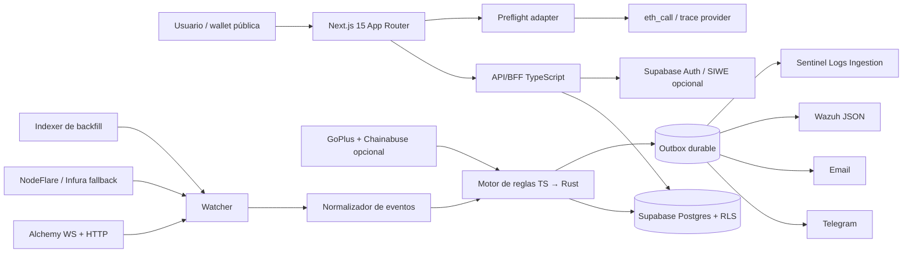
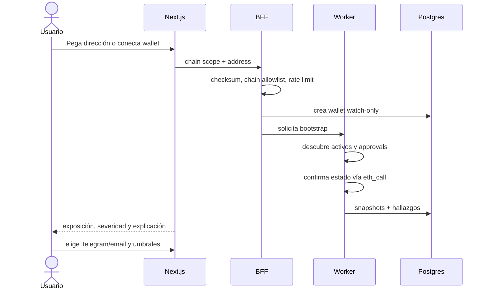
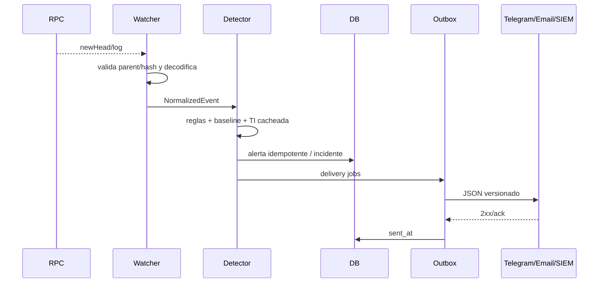

# DeFi Sentinel — research y blueprint técnico

> Estado del research: 29 de septiembre de 2026. Los límites y precios cambian; los enlaces de la matriz de dependencias son la fuente de verdad que debe revisarse antes de desplegar.

## 1. Decisión ejecutiva

DeFi Sentinel debe construirse como un sistema **watch-only** compuesto por una aplicación Next.js, un monitor de larga duración, PostgreSQL y adaptadores de salida. No debe firmar ni transmitir transacciones. La wallet conectada aporta únicamente una dirección pública; también se debe permitir pegar una dirección sin conectar nada.

La mejor secuencia para un portafolio de seis semanas es:

1. **MVP TypeScript de extremo a extremo**: Next.js 15.5.18, viem/wagmi, Supabase, Alchemy como RPC primario y NodeFlare/Infura como fallback. Un worker Node.js/TypeScript reduce cambio de contexto y permite demostrar el producto antes de optimizar.
2. **SOC Lite con motor Rust**: extraer sólo el camino caliente —ingesta WebSocket, normalización, reglas y outbox— a Rust con Tokio + Alloy cuando las mediciones lo justifiquen. Rust es una señal valiosa de portafolio, pero no es requisito técnico del MVP.
3. **Laboratorio Wazuh local y despliegue AWS con créditos**: Wazuh no es viable en una `t3.micro` de 1 GiB. Wazuh declara 2 GB/2 cores como mínimo para el servidor y 4 GB/8 cores como recomendado; una `t3.micro` tiene 1 GiB. Para una demo estable usar Docker local o una EC2 de al menos 4 GB, idealmente 8 GB, cubierta por créditos ([requisitos Wazuh](https://documentation.wazuh.com/current/installation-guide/wazuh-server/index.html), [familia EC2 T3](https://aws.amazon.com/ec2/instance-types/general-purpose/)).

La recomendación de SIEM es **Wazuh como implementación principal** y **Microsoft Sentinel como adaptador/documentación opcional**. Wazuh es abierto y reutilizable sin una ventana promocional; Sentinel ofrece 10 GB/día durante 31 días, pero después cobra por ingesta, por lo que no satisface “coste 0 permanente” ([Wazuh](https://documentation.wazuh.com/current/installation-guide/index.html), [facturación Sentinel](https://learn.microsoft.com/en-us/azure/sentinel/billing)).

## 2. Alcance y objetivos medibles

### Resultado útil personal

- Ver valor y composición de 1–10 wallets en Ethereum, Base, Arbitrum, Optimism, Polygon y BNB Chain.
- Inventariar approvals ERC-20, ERC-721/1155 y Permit2; ordenar por “valor expuesto”, no sólo por cantidad.
- Recibir Telegram/email cuando aparezca una autorización peligrosa o una salida anómala.
- Abrir un enlace seguro a Revoke.cash o al approval checker oficial del explorer. DeFi Sentinel **no revoca por el usuario**.

### Resultado demostrable de portafolio

- Ocho reglas de drainer reproducibles, cada una con pruebas positivas y negativas.
- Alertas normalizadas y correlacionadas en Wazuh; adaptador equivalente para Sentinel.
- Métricas públicas: precisión/recall sobre el corpus etiquetado, falsos positivos por 1.000 eventos, p50/p95 de detección, tiempo hasta la notificación y disponibilidad del worker.
- Video o captura de una cadena completa: evento de prueba → detección → alerta Telegram → incidente Wazuh.

### No-objetivos iniciales

- Custodia, firma, ejecución automática de revokes o bloqueo de transacciones.
- “Detección universal” de todo exploit DeFi.
- Vigilancia fiable del mempool privado. GenDetect también reconoce que las transacciones enviadas sólo por relays privados no son visibles antes de su inclusión ([paper, §6](https://yajin.org/papers/icse2026_gendetect.pdf)).
- ML en fase 1. Las reglas explicables y baselines por wallet dan más valor SOC y son auditables.

## 3. Arquitectura final



### Por qué separar BFF, watcher y detector

- Las funciones de Vercel son efímeras; no son el lugar adecuado para WebSockets permanentes. El plan Hobby es útil para el frontend personal, pero sus funciones tienen duración máxima y cuotas ([Vercel Hobby](https://vercel.com/docs/plans/hobby)).
- El watcher necesita reconexión, checkpoint de bloque, reorg handling y backpressure.
- El detector debe poder reproducir un evento histórico sin acceder a la red; esto vuelve deterministas las pruebas.
- El outbox evita perder notificaciones si Telegram, email o SIEM fallan temporalmente.

### Topología por entorno

| Entorno | Coste | Componentes |
|---|---:|---|
| Desarrollo | 0 | Next.js local, Postgres/Supabase local, worker TS/Rust, Wazuh all-in-one en Docker, Anvil para fixtures |
| Demo pública | 0 mientras esté dentro de cuotas | Vercel Hobby + Supabase Free + Alchemy Free; worker ejecutado localmente durante la demo |
| Personal 24/7 | Créditos AWS | worker en `t4g.small`/`t4g.medium`; Wazuh separado en instancia con ≥4 GB, preferible 8 GB; frontend/DB siguen en free tier |
| Producción futura | Variable | dos RPC providers, cola gestionada, Postgres de pago, Wazuh/Sentinel según volumen, alta disponibilidad |

No se debe llamar “free tier de EC2” a Wazuh sobre una micro. Las cuentas AWS creadas desde el 15-jul-2025 operan con créditos por seis meses o hasta agotarlos, y la elegibilidad depende del tipo de cuenta ([AWS EC2 Free Tier](https://docs.aws.amazon.com/AWSEC2/latest/UserGuide/ec2-instance-launch-parameters.html)).

## 4. Stack recomendado

### Frontend y API

- **Next.js 15.5.18 + TypeScript estricto** si Next 15 es un requisito de portafolio. La versión 15 debe fijarse al parche de seguridad 15.5.18; versiones 15 anteriores tienen advisories corregidos en mayo de 2026 ([release de seguridad](https://vercel.com/changelog/next-js-may-2026-security-release)). Si no existe ese requisito, iniciar directamente con la rama estable actual de Next.
- App Router, Server Components para lecturas, Route Handlers para webhooks y Server Actions sólo para mutaciones autenticadas.
- **viem** para RPC/ABI y **wagmi** para conexión de wallet. Validación con Zod/Valibot y checksum de direcciones con viem.
- Tailwind/shadcn sólo para acelerar la interfaz; no es parte de la propuesta de seguridad.

Next advierte que toda entrada del cliente debe validarse y que cada Server Action es un endpoint público que necesita autenticación y autorización propias ([guía de seguridad Next 15](https://nextjs.org/docs/15/app/guides/data-security)).

### Monitor y motor de reglas

- **Semana 1–2:** Node.js/TypeScript, viem, un loop por cadena y una interfaz `ChainAdapter`.
- **Semana 3–4:** crate Rust `sentinel-engine` con Tokio, Alloy, serde, tracing, sqlx y reqwest. La API web no se reescribe: consume el mismo esquema de eventos y tablas.
- Redis no es necesario al principio. PostgreSQL con `FOR UPDATE SKIP LOCKED` implementa una cola/outbox suficientemente robusta. Añadir Upstash sólo si las métricas muestran contención; su plan gratuito actual incluye 256 MB y 500.000 comandos/mes ([Upstash](https://upstash.com/pricing/redis)).

**Criterio de extracción a Rust:** hacerlo si p95 de decode+rule supera 500 ms, si un proceso TS no sostiene el volumen de las cadenas elegidas o si la pieza Rust es un objetivo deliberado de portfolio. El benchmark de GenDetect no debe copiarse como promesa: logró >2.000 TPS en **96 cores**, latencia media de matching cercana a 0,1 s y peor caso ~0,7 s; no es comparable con una VM pequeña ([GenDetect, pp. 9–10](https://yajin.org/papers/icse2026_gendetect.pdf)).

### Base de datos

**Elección: Supabase Free.** Incluye Postgres, Auth, Realtime y RLS, y actualmente dos proyectos activos, 500 MB de base por proyecto, 5 GB de egress y 50.000 MAU ([cuotas Supabase](https://supabase.com/docs/guides/platform/billing-on-supabase)). Es preferible a Neon para este proyecto porque Auth + RLS reducen trabajo de multiusuario en fase 3.

**Alternativa: Neon** si se desea Postgres puro y branching. El free tier vigente anuncia 0,5 GB por proyecto y cómputo con scale-to-zero; se debe consultar la página de precios al desplegar porque sus límites han cambiado varias veces ([Neon Free](https://neon.com/blog/how-to-make-the-most-of-neons-free-plan)).

### Esquema mínimo

```text
users                 id, email, created_at
wallets               id, user_id, chain_scope, address, label
chain_cursors         chain_id, stream, last_finalized_block, block_hash
assets                chain_id, contract, standard, symbol, decimals
balance_snapshots     wallet_id, asset_id, block_number, raw_balance, usd_value
approval_snapshots    wallet_id, token, spender, standard, amount, expires_at, active
normalized_events     id, chain_id, block, tx_hash, log_index, event_type, payload
detection_rules       id, version, enabled, severity_default, config
alerts                id, user_id, rule_id, severity, confidence, evidence, status
incidents             id, user_id, state, score, first_seen, last_seen
incident_alerts       incident_id, alert_id
delivery_outbox       id, alert_id, destination, attempts, next_attempt_at, sent_at
counterparty_profile  wallet_id, address, first_seen, count, value_sum, trust_state
```

Claves únicas: `(chain_id, tx_hash, log_index, event_type)` para idempotencia y `(wallet_id, token, spender, standard)` para el estado actual. Todas las tablas de usuario incluyen `user_id`; RLS exige `auth.uid() IS NOT NULL AND auth.uid() = user_id`. Supabase recomienda habilitar RLS en cada tabla expuesta y recuerda que la `service_role` omite RLS y debe permanecer sólo en servidor ([RLS](https://supabase.com/docs/guides/database/postgres/row-level-security)).

## 5. Datos on-chain: opciones verificadas

| Servicio | Free tier confirmado | Uso recomendado | Riesgo/limitación |
|---|---|---|---|
| [Alchemy](https://www.alchemy.com/docs/reference/pricing-plans) | 30 M CU/mes, 300 CU/s documentados; WebSockets y APIs enriquecidas | Primario para MVP, WebSocket + Transfers API/backfill | cuotas CU; implementar 429/retry; la cifra de CUP/s aparece distinta en soporte, por lo que medir el dashboard de la cuenta |
| [Infura](https://docs.infura.io/get-started/pricing/) | 3 M créditos/día, 500 créditos/s | fallback HTTP/WS | un solo API key en Core; cada evento WS consume créditos |
| [NodeFlare](https://nodeflare.app/pricing) | 2 M CU/mes, 10 req/s, 18 cadenas | fallback multichain y prototipos | servicio joven; `/simulate` y discovery pesado no son gratuitos en la capa pública |
| RPC público de la cadena | sin cuenta | último fallback, health checks | sin SLA, rate limits variables; nunca depender de uno para alertas críticas |
| [The Graph](https://thegraph.com/docs/en/subgraphs/querying/introduction/) | 100.000 queries/mes | portfolio/protocol positions donde exista subgraph | no es un feed universal; retraso y esquema por protocolo |
| [evmscope](https://github.com/calintzy/evmscope) | OSS, sin keys por defecto | herramienta de exploración/referencia | proyecto comunitario pequeño; no usar como dependencia crítica ni como fuente de verdad |
| Snubb ([anuncio Envio](https://envio.beehiiv.com/p/envio-developer-update-april-2025)) | CLI OSS, hasta ~70 cadenas según el proyecto | comparar resultados de approvals y generar fixtures | no es una API gestionada; actividad/mantenimiento limitados; vendorizar sólo ideas, no depender de salida no versionada |
| [GoPlus](https://gopluslabs.io/en/security-api) | 150k CU/mes, 30k/día, 150/min publicados | reputación de token/spender/dApp y simulación complementaria | inteligencia de tercero; cachear y guardar evidencia/fecha |
| [Chainabuse](https://docs.chainabuse.com/docs/getting-started-2-1) | sólo 10 llamadas/mes estándar | lookup manual/enrichment de alertas críticas | demasiado bajo para streaming; nunca usar en el camino caliente |

### Estrategia de ingesta recomendada

1. **Escaneo inicial indexado:** descubrir activos y contratos relevantes con Transfers API/subgraphs. Para cada par owner-token-spender candidato, confirmar el estado actual mediante `eth_call` (`allowance`, `isApprovedForAll`, Permit2 `allowance`). Los logs históricos solos no bastan si hay eventos faltantes o implementaciones no estándar.
2. **WebSocket `newHeads` + logs filtrados:** procesar los logs del bloque nuevo para las wallets monitorizadas. Las direcciones owner/from están indexadas en los eventos estándar, lo que permite filtros por topic; dividir filtros si el proveedor limita el número de topics.
3. **Checkpoint y finalización:** guardar `(block_number, block_hash)`. En “fast mode”, alertar al primer bloque y marcar `provisional`; confirmar tras N bloques. Si el hash cambia, revertir snapshots derivados y emitir `alert_reorged`.
4. **Polling de reconciliación:** cada 5–15 minutos verificar balances/allowances de alto riesgo y reconsultar desde `last_finalized_block + 1`. Es recuperación, no camino principal.
5. **Fallback:** circuito por proveedor, exponential backoff con jitter, health score y límite de concurrencia. Nunca exponer API keys al browser.

### Polling vs WebSocket vs indexador

| Método | Latencia | Coste | Fortalezas | Debilidades | Rol |
|---|---:|---:|---|---|---|
| Polling por bloque | 1 bloque + intervalo | medio/alto | simple y recuperable | duplica llamadas, puede perder ventana si el proceso cae | fallback y reconciliación |
| WebSocket | sub-bloque a 1 bloque | bajo/medio | respuesta más rápida y menos polling | desconexiones silenciosas, cuota por evento | camino caliente |
| Indexador | 1–varios bloques | eficiente para histórico | queries de portfolio/positions | retraso, cobertura y dependencia | bootstrap/backfill |
| Mempool | potencialmente pre-bloque | alto | alerta temprana | privados/MEV relays invisibles, falsos positivos por tx revertida | fase 3 experimental |

Ethereum produce slots de 12 s ([ethereum.org](https://ethereum.org/developers/docs/blocks/)); para BNB el research citado por GenDetect usa 3 s. SLO propuesto: `p95(block_seen → alert_persisted) < 1,5 s` en BNB y `< 4 s` en Ethereum; `p95(alert_persisted → webhook accepted) < 3 s`. “Dentro del block interval” se mide desde que el proveedor entrega el bloque, no desde que el usuario firma.

## 6. Taxonomía operacional de ocho clases

La taxonomía siguiente es propia de DeFi Sentinel y está diseñada para ser implementable. Distingue **observable on-chain**, **observable sólo si la app intercepta la firma** y **observable tras ejecución**. Una firma off-chain no publicada no puede detectarse desde un RPC.

| ID | Clase | Artefacto | ¿Decodificable? | Regla propuesta | Sev. base |
|---|---|---|---|---|---|
| DS-001 | ERC-20 allowance ilimitado | calldata `approve(spender,value)`, evento `Approval`, estado `allowance` | Sí, on-chain | `value >= 2^255` o `allowance / max(balance,1) >= K`; elevar si spender nuevo/no verificado/malicioso | Media conocida; Alta desconocida; Crítica TI maliciosa |
| DS-002 | Operador NFT global | `setApprovalForAll(operator,true)`, `ApprovalForAll` ERC-721/1155 | Sí, on-chain | operador global + colección con balance >0; elevar por valor, operador nuevo o reputación | Alta |
| DS-003 | Permit ERC-2612/DAI | EIP-712 firmado off-chain; después calldata `permit` y `Approval` | Sólo en preflight antes del relay; sí al ejecutarse | dominio/chain/verifyingContract, spender, value y deadline; alertar max value, deadline largo, dominio incoherente | Alta |
| DS-004 | Permit2 AllowanceTransfer máximo | typed data; evento `Permit/Approval`; estado Permit2 `(amount,expiration,nonce)` | Preflight o tras inclusión | `amount == type(uint160).max`, expiración >30d o spender no allowlisted; comprobar que token aprobó al contrato Permit2 | Alta |
| DS-005 | Permit2 SignatureTransfer / batch pull | typed data + `permitTransferFrom`/`permitWitnessTransferFrom` | Preflight o en tx de ejecución | requested amount > umbral, varios tokens, destinatario no relacionado, nonce/deadline sospechosos | Crítica si vacía ≥X% |
| DS-006 | Orden NFT Seaport/Blur engañosa | orden EIP-712 off-chain: offer, consideration, recipient, conduit/market | Preflight; tras fulfilment sólo se ven transferencias/orden | usuario entrega NFT/activo valioso y recibe 0 o valor muy inferior; recipient/conduit/contract no oficial; bulk order inesperada | Crítica |
| DS-007 | Sweep directo/multicall anómalo | transfers nativos/ERC-20/721/1155, internal traces, multicall | Sí tras simulación o inclusión; parcial sin traces | salida ≥X% del portfolio, ≥N activos/tx o ventana, contraparte nueva, approval+pull mismo bloque | Alta/Crítica |
| DS-008 | Upgrade de proxy seguido de salida | `Upgraded`, `BeaconUpgraded`, `AdminChanged`, slot ERC-1967, code hash nuevo + transfers | Sí on-chain; intención no | contrato tocado/approved cambia implementación y en M bloques mueve fondos; elevar si implementación no verificada/código reciente/admin nuevo | Alta/Crítica |

Fuentes normativas: ERC-20 define `Approval`, `approve` y `allowance` ([EIP-20](https://eips.ethereum.org/EIPS/eip-20)); ERC-721 establece que `setApprovalForAll` permite gestionar todos los NFT ([EIP-721](https://eips.ethereum.org/EIPS/eip-721)); ERC-1155 aplica el mismo patrón al conjunto de tokens ([EIP-1155](https://eips.ethereum.org/EIPS/eip-1155)); ERC-2612 permite cambiar allowances mediante firma EIP-712 ([EIP-2612](https://eips.ethereum.org/EIPS/eip-2612)); Permit2 guarda amount, expiration y nonce y trata `type(uint160).max` como máximo ([Uniswap Permit2](https://github.com/Uniswap/permit2/blob/main/src/AllowanceTransfer.sol)); Seaport usa órdenes firmadas con `offer` y `consideration` ([modelo Seaport](https://docs.opensea.io/docs/seaport-models)); ERC-1967 define slots y eventos de upgrade y afirma que monitorizar proxies es esencial ([ERC-1967](https://eips.ethereum.org/EIPS/eip-1967)).

### Señales de anomalía que modifican el score

```text
risk = rule_base
     + 25 if threat_intel == malicious
     + 15 if counterparty_first_seen
     + 15 if asset_out_pct >= 80
     + 10 if asset_count >= 3
     + 10 if approval_and_pull_same_tx_or_block
     + 10 if contract_age < 7d or unverified
     + 10 if proxy_upgraded_within_M_blocks
     - 20 if exact official contract allowlist + expected selector
     - 10 if amount/deadline matches learned user baseline
```

`0–29 Info`, `30–49 Low`, `50–69 Medium`, `70–84 High`, `85–100 Critical`. La allowlist nunca suprime evidencia: reduce score y queda registrada la razón. Un contrato “popular/verificado” no es automáticamente seguro; sus proxies pueden actualizarse y sus interfaces pueden comprometerse.

## 7. Flujos de usuario y sistema

### Onboarding



La conexión wallet nunca solicita firma para el escaneo. Si se añade SIWE, la firma sólo prueba control de la dirección y debe mostrar un mensaje legible, nonce y dominio correctos.

### Monitoreo continuo y respuesta



La alerta incluye `qué pasó`, `por qué importa`, `evidencia`, `confianza`, `acción segura` y enlaces al explorer/Revoke.cash. Nunca enlaza una transacción preconstruida ni pide seed/private key.

### Integración SIEM

Evento canónico:

```json
{
  "schema_version": "1.0.0",
  "event_id": "01J...",
  "event_time": "2026-09-29T14:23:04Z",
  "event_kind": "alert",
  "product": "defi-sentinel",
  "rule": {"id": "DS-005", "version": 1, "name": "permit2_batch_sweep"},
  "severity": 95,
  "confidence": 0.97,
  "chain": {"id": 1, "name": "ethereum", "block": 123, "finality": "provisional"},
  "transaction": {"hash": "0x...", "explorer_url": "https://etherscan.io/tx/0x..."},
  "wallet": {"address": "0x...", "user_ref": "pseudonymous-id"},
  "actor": {"address": "0x...", "reputation": "malicious"},
  "assets": [{"contract": "0x...", "symbol": "USDC", "raw_amount": "1000000", "usd": 1.0}],
  "evidence": ["Permit2 max amount", "new recipient", "100% balance requested"],
  "recommended_action": "Do not sign; inspect and revoke existing Permit2 allowance",
  "dedupe_key": "1:0x...:DS-005"
}
```

- **Wazuh:** escribir JSON Lines en un archivo leído por el agente o enviar syslog/TLS. Wazuh ya incluye decoder JSON y permite referenciar campos dinámicos en reglas; validar cada muestra con `wazuh-logtest` ([decoder JSON](https://documentation.wazuh.com/current/user-manual/ruleset/decoders/json-decoder.html), [reglas](https://documentation.wazuh.com/current/user-manual/ruleset/ruleset-xml-syntax/rules.html)).
- **Sentinel:** POST de un array JSON a Logs Ingestion API → DCR → tabla `DeFiSentinel_CL`, autenticado con una app de Entra con permiso mínimo sobre la DCR. Microsoft documenta el endpoint, TLS 1.2+, custom tables y transformaciones ([Logs Ingestion API](https://learn.microsoft.com/en-us/azure/azure-monitor/logs/logs-ingestion-api-overview)).
- Correlaciones: `approval high + transferFrom en ≤10 min`, `upgrade + salida en ≤20 bloques`, `≥3 wallets vigiladas → mismo recipient en 1 h`, `mismo spender obtiene ≥5 approvals en 15 min`.

### Preflight “¿qué pasará si firmo?”

1. La UI recibe una solicitud EIP-712 o una transacción **sin firmar**.
2. Decodifica dominio, tipos, calldata, spender, recipients, deadlines y máximos localmente.
3. Simula con `eth_call`; si existe un proveedor de traces, calcula asset diffs e internal calls.
4. Ejecuta las mismas ocho reglas en modo `preflight`.
5. Devuelve `safe / caution / dangerous / unknown`, nunca un “seguro” absoluto.

No construir la fase 3 sobre `alchemy_simulateAssetChanges`: Alchemy anuncia deprecación el 30-sep-2026 aunque el free tier ofrecía 1.000 simulaciones/día ([FAQ oficial](https://www.alchemy.com/docs/reference/simulation-faqs)). NodeFlare expone `/data/simulate`, pero la simulación es trabajo pesado con key/x402, no parte inequívoca del acceso público gratuito ([NodeFlare Data API](https://nodeflare.app/data)). La ruta sostenible es un adaptador: `eth_call` básico siempre disponible + proveedor de trace configurable + motor local de diffs cuando haya créditos.

## 8. Seguridad de DeFi Sentinel

### Invariantes

- Nunca aceptar, solicitar, registrar ni transmitir private keys, seed phrases o keystores.
- Prohibir `eth_sendRawTransaction`, métodos `wallet_*` de escritura y cualquier signer en backend mediante allowlist de métodos RPC de lectura.
- Guardar direcciones públicas; no guardar firmas EIP-712 después de analizarlas salvo hash/redacción explícita.
- Secrets sólo en el runtime del servidor. En AWS usar Secrets Manager/IAM y rotación; AWS recomienda no hardcodear, cifrar con KMS, cachear y aplicar mínimo privilegio ([AWS Secrets Manager](https://docs.aws.amazon.com/secretsmanager/latest/userguide/best-practices.html)). En local, `.env.example` sin valores y secret scanning en CI.

### Validación y aislamiento

- `chain_id` pertenece a una allowlist y se empareja con su RPC; dirección EVM de 20 bytes y checksum normalizado.
- Contratos se validan con `eth_getCode`; no asumir que “tiene código” implica seguridad.
- URLs de webhook: HTTPS, host allowlisted o resolución DNS/IP bloqueando loopback, link-local, RFC1918 y metadata cloud; redirecciones deshabilitadas. OWASP recomienda construir destinos desde allowlists y no confiar en URLs arbitrarias por riesgo SSRF ([OWASP SSRF](https://cheatsheetseries.owasp.org/cheatsheets/Server_Side_Request_Forgery_Prevention_Cheat_Sheet.html)).
- RLS `user_id = auth.uid()` en toda fila; índices por `user_id`; pruebas que intenten leer/escribir datos de otro usuario.
- Rate limits por usuario/IP/wallet, body limit pequeño, timeouts y límites de logs/bloques por consulta.
- Egress allowlist desde el worker sólo a RPCs, DB, Telegram/email y SIEM.

### Supply chain y observabilidad

- `pnpm --frozen-lockfile`, Dependabot/Renovate, CodeQL, Semgrep, cargo-audit, Trivy y Gitleaks.
- SBOM CycloneDX en releases; imágenes por digest y usuario no-root.
- Logs estructurados sin API keys, emails completos, firmas ni payloads potencialmente secretos.
- Métricas: RPC error/429, lag de bloque, reorgs, queue age, rule latency, alert counts, delivery failures y false-positive disposition.

## 9. Testing, validación y debugging

### Pirámide

1. **Unitarias:** ABI decoders, normalización, score, dedupe, expiraciones, thresholds y serialización SIEM.
2. **Property/fuzz:** cantidades `uint160/256`, deadlines, arrays Permit2/Seaport, ABI truncada, eventos duplicados y orden aleatorio.
3. **Integración local:** Anvil con contratos mock; cada clase produce un fixture positivo y al menos dos negativos.
4. **Fork tests:** reproducir bloques/transacciones públicas fijando chain+block. Nunca depender de `latest` en CI.
5. **End-to-end:** evento → DB → incidente → outbox → fake Telegram/email → Wazuh/Sentinel test sink.
6. **Resiliencia:** desconectar WebSocket, 429, timeouts, reorg simulado, DB caída, delivery 500 y reinicio a mitad de bloque.

### Matriz de las ocho clases

| Regla | Positivo mínimo | Negativos obligatorios | Aserción |
|---|---|---|---|
| DS-001 | `approve(maxUint256)` a spender nuevo | allowance exacta para swap; `approve(0)` | estado activo y severidad correcta |
| DS-002 | `setApprovalForAll(attacker,true)` | operador oficial; revoke `false` | colección/valor expuesto presentes |
| DS-003 | permit max con deadline largo | permit limitado/corto y dominio correcto | captura en preflight y tras ejecución |
| DS-004 | Permit2 maxUint160 + 30d+ | allowance pequeña y expira pronto | amount/expiration/nonce decodificados |
| DS-005 | batch de 3 tokens a recipient nuevo | pull único esperado hacia router oficial | critical y `asset_count=3` |
| DS-006 | NFT sale por 0/consideration hostil | venta OpenSea coherente con precio | ratio de valor y recipients explicados |
| DS-007 | 90% portfolio en 2 min | retiro conocido; bridge oficial | baseline y ventana temporal reproducibles |
| DS-008 | upgrade a código no verificado + drain | upgrade governance conocido sin salida | correlación por bloques, no alerta aislada crítica |

Corpus negativo: routers y marketplaces oficiales con direcciones versionadas, transacciones normales propias anonimizadas y contratos verificados populares. Corpus positivo: mocks propios y casos públicos con licencia/atribución; DeFiHackLabs ofrece reproducciones de exploits para ampliar fase 3. Separar `train/tune` y `holdout`; no ajustar thresholds mirando el holdout.

### Métricas de calidad

- `precision`, `recall`, `F1` por regla y macro-promedio.
- FPR por 1.000 eventos y por wallet-día.
- `MTTD = alert.persisted_at - block.provider_seen_at`.
- `notification_delay = delivery.accepted_at - alert.persisted_at`.
- `block_lag = head - cursor`.
- Objetivo fase 2: 100% recall en fixtures sintéticos, ≥95% precision en corpus curado, FPR <5/1.000, p95 MTTD dentro del intervalo de bloque.

### Playbook de latencia

1. Timestamp monotónico en `rpc_received`, `decoded`, `rules_done`, `db_committed`, `delivery_accepted`.
2. Separar tiempo de proveedor de tiempo propio.
3. Perfilar consultas (`EXPLAIN ANALYZE`), tamaño del filtro de topics y serialización.
4. Si hay lag: reducir cadenas/wallets por shard, agrupar `eth_call`, cachear metadata, mover enrichment TI fuera del camino caliente y paralelizar por chain/block.
5. Comparar worker TS y Rust con el mismo replay NDJSON; publicar hardware y dataset para evitar benchmarks engañosos.

## 10. Fases y roadmap de seis semanas

### Fase 1 — MVP (semanas 1–2)

**Semana 1**

- Monorepo `apps/web`, `services/watcher`, `packages/domain`, `packages/rules`, `infra`.
- Next.js, diseño watch-only, conexión/pegar wallet, Supabase schema + RLS.
- Chain registry y adaptadores Alchemy/Infura/NodeFlare; health/fallback.
- Escaneo inicial de balances y approvals ERC-20/721/1155 en Ethereum + Base.
- CI, secret scanning y contratos mock.

**Semana 2**

- Dashboard portfolio, tabla de exposición, DS-001/DS-002.
- Telegram + email mediante outbox, dedupe y retries.
- Reconcile job, cursors y reorg básico.
- Pruebas unitarias/integración y primera demo grabada.

**Exit:** una wallet escaneada, una approval ilimitada detectada y una alerta entregada con explicación/revoke link.

### Fase 2 — SOC Lite (semanas 3–4)

**Semana 3**

- DS-003…DS-008, preflight decoder sin firmar y baselines de salida.
- Enrichment GoPlus; allowlist oficial versionada.
- Motor Rust detrás de contrato JSON, comparado contra implementación TS.
- Taxonomía/severidad y dashboard de incidentes.

**Semana 4**

- Wazuh Docker, decoder JSON, reglas de correlación y dashboard.
- Adaptador Sentinel + DCR/KQL documentado y probado con test sink o trial.
- Replay harness, ocho positivos, ≥16 negativos, reorg/429/caídas.
- Benchmark reproducible y panel de métricas.

**Exit:** ocho clases detectadas, incidente correlacionado en Wazuh y reporte de precisión/latencia.

### Fase 3 — Production-shaped (semanas 5–6)

**Semana 5**

- Simulación `eth_call` + adapter de trace, decodificación completa EIP-712/Seaport/Permit2.
- Feed TI cacheado y versionado; reportes JSON/CSV/PDF sin datos secretos.
- Multiusuario, RLS adversarial tests, quotas y data retention.
- Deploy AWS con créditos, Terraform mínimo, backups y runbooks.

**Semana 6**

- Hardening, threat model STRIDE, SBOM, scans y performance.
- UX de triage: acknowledge, false positive, escalate, resolved.
- README final, arquitectura, ADRs, screenshots, video de 2–3 min y postmortem.
- Publicar métricas honestas y backlog post-MVP.

**Exit:** demo pública read-only, monitor 24/7, preflight explicable, SIEM, documentación reproducible y cero secretos en repo.

## 11. Backlog inicial priorizado

| Orden | Tarea | Tamaño | Aceptación |
|---:|---|---:|---|
| 1 | Bootstrap monorepo y CI | S | lint/typecheck/test/Gitleaks pasan |
| 2 | Schema + RLS + pruebas tenant isolation | M | usuario A no puede leer/escribir B |
| 3 | Chain/RPC adapter con failover | M | reconecta, maneja 429 y checkpoint |
| 4 | Bootstrap wallet balances/approvals | L | Ethereum+Base, estado confirmado por call |
| 5 | DS-001 y DS-002 + fixtures | M | positivos/negativos verdes |
| 6 | Outbox Telegram/email | M | retry idempotente y dead letter visible |
| 7 | Dashboard portfolio/exposure | M | valor, spender, riesgo, evidencia, revoke link |
| 8 | NormalizedEvent v1 + replay CLI | M | mismo input produce mismo alert hash |
| 9 | DS-003…DS-008 | XL | matriz completa y coverage por regla |
| 10 | Wazuh decoder/rules/dashboard | L | JSON parseado y correlación visible |
| 11 | Rust engine benchmark | L | comparación reproducible vs TS |
| 12 | Preflight adapter | XL | calldata/EIP-712 + `eth_call`, resultado explicable |

## 12. Riesgos y mitigaciones

| Riesgo | Impacto | Mitigación |
|---|---|---|
| approvals históricos incompletos | exposición omitida | indexador para discovery + `eth_call` como verdad actual |
| proveedor WS cae sin cerrar | lag silencioso | heartbeat, head lag metric, polling de reconciliación y segundo RPC |
| firma off-chain invisible | falsa sensación de cobertura | declarar límites; preflight sólo cuando el usuario comparte el payload |
| allowlist obsoleta/contrato actualizable | falso negativo | versionar, expiración, vigilar proxy/admin y nunca suprimir evidencia |
| precios USD erróneos | score incorrecto | múltiples fuentes, timestamp, confidence y regla por porcentaje de balance |
| reorg | alerta incorrecta | provisional/finalized, block hash checkpoint y compensación |
| SIEM consume secretos/PII | exposición | pseudonymous user refs, redactar payloads, TLS, mínimo privilegio |
| coste inesperado | bloqueo del proyecto | hard caps, budgets/alerts, dos modos: local $0 y AWS credits |

## 13. Conclusión

El valor diferencial no será “otro portfolio tracker”, sino la **cadena de evidencia SOC**: ingesta resistente, reglas explicables sobre primitivas Web3, incidente correlacionado, envío SIEM y respuesta segura. El proyecto debe mostrar límites con honestidad: una firma privada no publicada no puede verse on-chain, un proveedor gratuito no equivale a SLA y un benchmark en 96 cores no predice una EC2 pequeña. Esa disciplina es precisamente lo que vuelve creíble a un perfil junior híbrido SOC + Web3.
